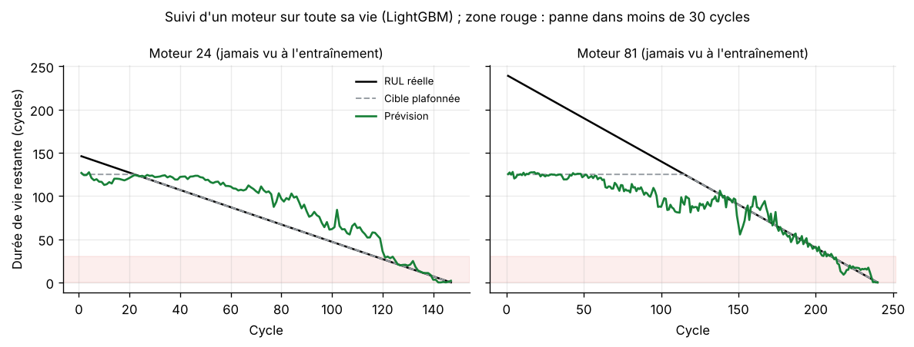
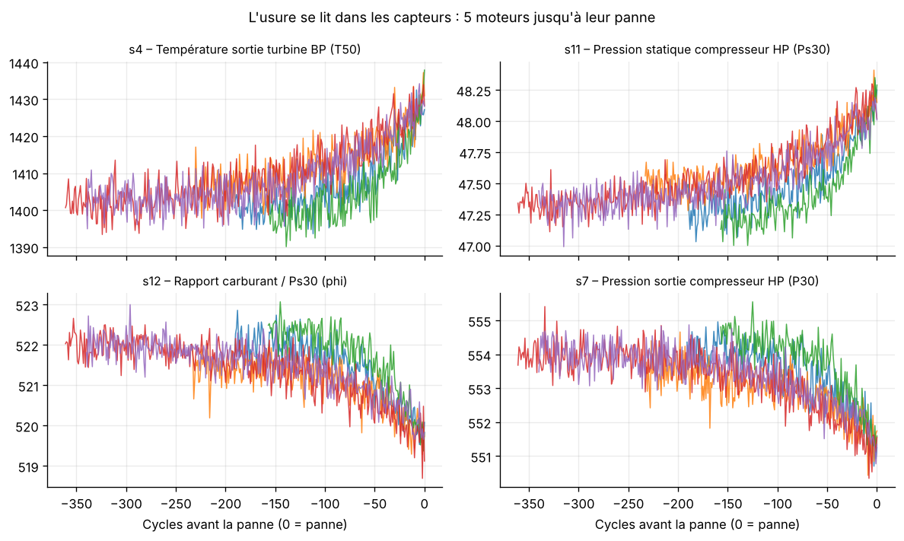
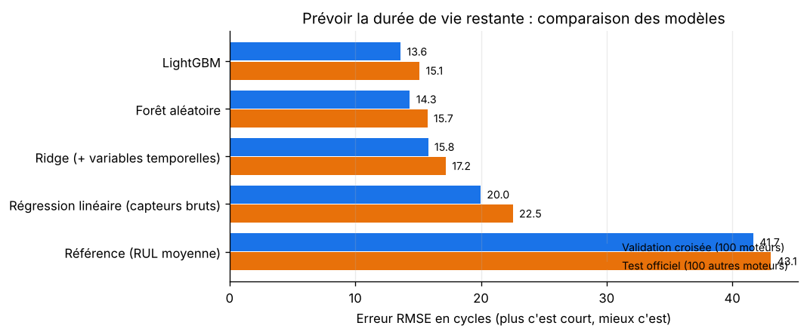
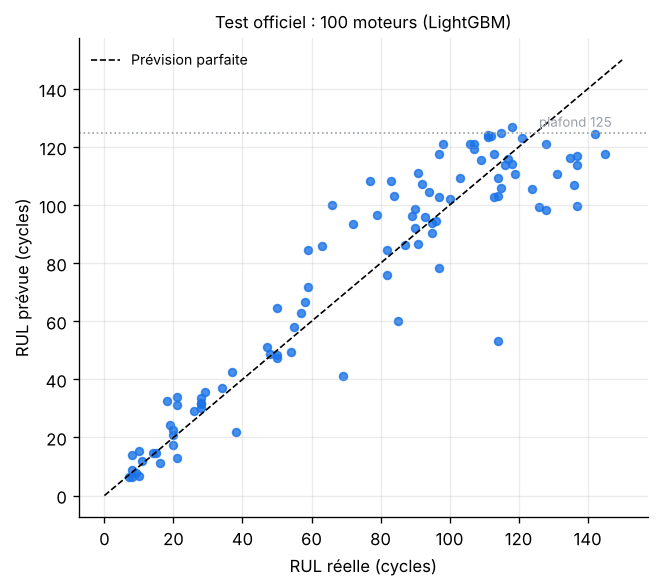
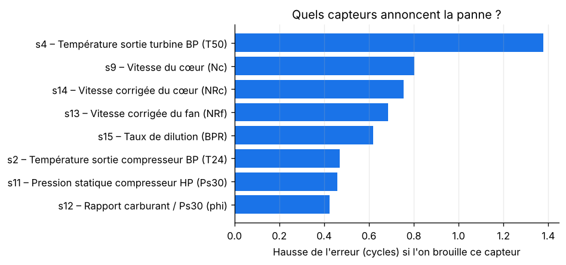
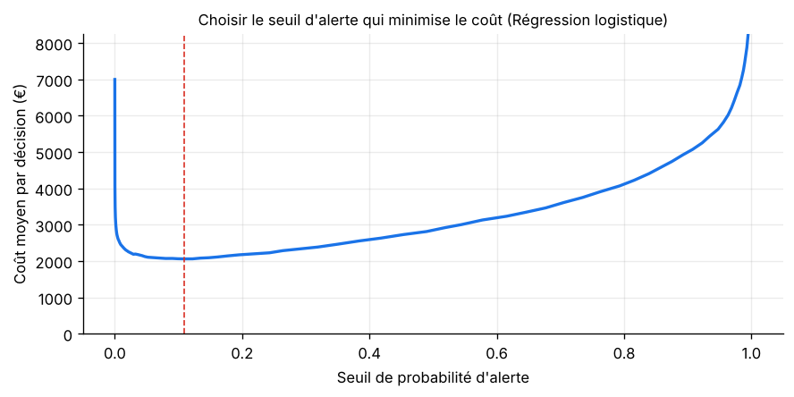

<div align="center">

# ✈️ Maintenance prédictive de moteurs d'avion

**Prévoir combien de cycles de vol il reste à un moteur avant sa panne, et décider quand le réviser.**

Régression (durée de vie restante) · classification (panne imminente) · optimisation du coût de maintenance — données NASA


</div>

---

## 🎯 Le problème

Un moteur d'avion s'use à chaque vol. Le réviser **trop tôt** coûte cher (avion immobilisé, pièces encore bonnes remplacées) ;
le réviser **trop tard**, c'est risquer une panne : avion cloué au sol, réparation lourde, retards en cascade.

Les capteurs du moteur (températures, pressions, vitesses) enregistrent l'usure. Le projet répond à deux questions :
1. **Régression** : combien de cycles de vol reste-t-il avant la panne ? (*RUL : Remaining Useful Life*)
2. **Classification** : ce moteur tombera-t-il en panne dans les **30 prochains cycles** ? Si oui, on le révise.

**Données** : NASA C-MAPSS (*Prognostics Data Repository*), jeu FD001 (domaine public) — 100 moteurs simulés suivis jusqu'à la panne pour l'entraînement (20 631 cycles),
et 100 autres moteurs arrêtés avant la panne pour le test, dont la vraie durée de vie restante est connue.

---

## 🏆 Résultats

| | |
|---|---|
| **Durée de vie restante** | prévue à **15 cycles près** (RMSE) sur les 100 moteurs de test, contre 43 sans modèle |
| **Pannes imminentes** | **25 sur 25 anticipées**, 0 manquée, 3 fausses alertes sur 75 moteurs sains |
| **Coût de maintenance** (100 moteurs) | **280 k€**, contre 1 M€ en révisant tout et 2,5 M€ en attendant les pannes |



*Deux moteurs jamais vus pendant l'entraînement : en début de vie, le modèle ne voit pas d'usure (prévision plate) ;
dès que l'usure apparaît dans les capteurs, sa prévision rejoint la vraie durée de vie restante.*

---

## 🔬 La démarche

### 1. Lire l'usure dans les capteurs



Sur 21 capteurs, **7 restent constants** et sont écartés. Les 14 autres dérivent à l'approche de la panne :
la température en sortie de turbine monte, la pression en sortie de compresseur baisse…
Le signal est **bruité** : une mesure isolée dit peu de chose, c'est la **tendance** qui compte.

### 2. Construire des variables qui captent la tendance

Pour chaque capteur et à chaque cycle, en n'utilisant **que le passé** :
- moyennes glissantes sur 10 et 30 cycles (lissent le bruit) ;
- écart-type sur 10 cycles (instabilité) ;
- **pente sur 20 cycles** : la vitesse d'usure.

Un test automatique vérifie l'absence de fuite du futur : couper la vie des moteurs au cycle 50 ne doit pas changer
les variables calculées au cycle 50.

### 3. Plafonner la cible

En début de vie, un moteur neuf ne montre **aucune** usure : impossible de distinguer « 300 cycles restants » de « 200 ».
On plafonne donc la cible à **125 cycles** (pratique standard sur ce jeu) : le modèle apprend « pas d'usure visible »,
puis la décroissance réelle.

### 4. Valider par moteur, pas par ligne

> ⚠️ Le piège classique : mélanger les cycles au hasard entre entraînement et validation.
> Le modèle voit alors les cycles 1 à 99 et 101 à 200 d'un moteur, et « devine » le cycle 100 : le score est faussement excellent.

Ici, la validation croisée est **groupée par moteur** (`GroupKFold`) : un moteur est entièrement dans l'entraînement,
ou entièrement dans la validation. Puis le modèle est évalué une seule fois sur les **100 moteurs du test officiel**.

### 5. Comparer 5 modèles



| Modèle | RMSE validation | RMSE test | MAE test | Score NASA (test) |
|---|:-:|:-:|:-:|:-:|
| Référence (durée moyenne) | 41,7 | 43,1 | 35,9 | 33 629 |
| Régression linéaire (capteurs bruts) | 20,0 | 22,5 | 17,7 | 1 291 |
| Ridge (+ variables temporelles) | 15,8 | 17,2 | 14,0 | 437 |
| Forêt aléatoire | 14,4 | 15,7 | 11,7 | **382** |
| **LightGBM** | **13,6** | **15,1** | **11,0** | 385 |

- Les **variables temporelles** font le gros du travail : avec le même modèle linéaire, l'erreur passe de 20 à 16 cycles.
- Le **score NASA** pénalise davantage une prévision trop optimiste (on annonce la panne plus tard qu'en réalité)
  qu'une prévision prudente : c'est le bon critère pour la sécurité. LightGBM et la forêt aléatoire sont à égalité.



### 6. Quels capteurs annoncent la panne ?



La **température en sortie de turbine basse pression (T50)** est le meilleur témoin de l'usure, suivie des vitesses
du cœur du moteur. C'est cohérent avec le mode de panne simulé (dégradation du compresseur haute pression).

### 7. Décider : réviser ou non ?

Trois approches pour détecter une panne dans les 30 prochains cycles, comparées en validation croisée :

| Approche | ROC AUC | PR AUC |
|---|:-:|:-:|
| **Régression logistique** | **0,996** | **0,980** |
| Classifieur dédié (LightGBM) | 0,996 | 0,980 |
| Régression LightGBM seuillée (« alerte si RUL prévue ≤ x ») | 0,995 | 0,976 |

Les trois sont à égalité : la régression logistique, la plus simple, est retenue.
Le **seuil d'alerte** n'est pas fixé à 50 % : il minimise le coût de maintenance, avec ces hypothèses (modifiables) :
- une **révision préventive** coûte **10 000 €** ;
- une **panne non anticipée** coûte **100 000 €**.



Une panne coûte 10 fois plus cher qu'une révision : le seuil optimal est donc **bas** (11 % de probabilité).
On préfère quelques révisions de trop à une panne.

| Stratégie (100 moteurs de test) | Coût |
|---|:-:|
| Attendre les pannes | 2 500 000 € |
| Réviser tous les moteurs | 1 000 000 € |
| **Réviser sur alerte du modèle** | **280 000 €** (25 pannes évitées, 3 révisions inutiles) |

---

## 🚀 Lancer le projet

**Windows, en un double-clic** : `lancer.bat` installe tout, entraîne les modèles (environ 10 minutes) et ouvre les graphiques.

**À la main :**
```bash
python -m venv .venv
# Windows : .venv\Scripts\activate     macOS / Linux : source .venv/bin/activate
pip install -r requirements.txt
cd src && python -m maintenance.train && cd ..
pytest -v      # 6 tests
```

---

## 🗂️ Organisation du code

```
maintenance-predictive/
├── data/raw/                 Données NASA C-MAPSS FD001 (entraînement, test, RUL vraies, notice)
├── src/maintenance/
│   ├── data.py               Chargement, capteurs utiles, variables temporelles (sans fuite du futur)
│   └── train.py              Comparaison des modèles, classification, seuil de coût, figures
├── models/model.joblib       Modèles entraînés + seuil d'alerte
├── reports/                  metrics.json et figures
├── tests/test_maintenance.py 6 tests (fuite du futur, score NASA, coûts…)
└── lancer.bat
```

---

## 🧭 Limites et pistes

- Données **simulées** et un seul régime de vol (FD001) : les jeux FD002 à FD004 ajoutent 6 régimes de vol et
  2 modes de panne, une étape naturelle suivante (il faut alors normaliser les capteurs par régime).
- Les coûts sont **illustratifs** : en entreprise, ils viendraient du service maintenance et de la comptabilité.
- Pistes : réseaux récurrents (LSTM) ou convolutifs sur les séquences de capteurs, et **intervalles de confiance**
  sur la durée de vie restante (savoir quand le modèle hésite).

---

## 👤 Auteur

**Elie Samson Kombiwo** — Data Scientist (MLOps / LLMOps)
[GitHub](https://github.com/gitsam1path) · [LinkedIn](https://www.linkedin.com/in/elie-samson-kombiwo-4075a4284)

<sub>Données : A. Saxena, K. Goebel, D. Simon, N. Eklund, « Damage Propagation Modeling for Aircraft Engine Run-to-Failure Simulation »,
PHM 2008 — NASA Ames Prognostics Data Repository (domaine public).</sub>
